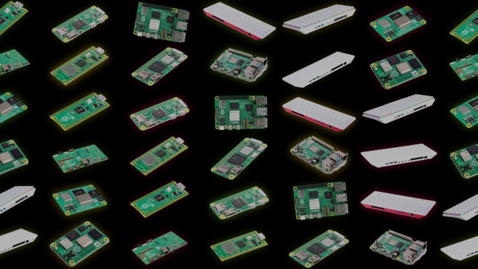
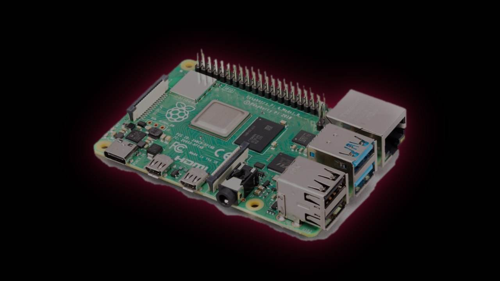

# A-Raspberry-Pi-Theme

A Raspberry Pi themed Batocera/ES theme



**Raspberry Circuit** is a simple animated EmulationStation theme in Raspberry Pi colours (raspberry red and leaf green). It's available in two versions as Batocera and ES-DE use different theme engines and can't share a single theme.xml.


## Features

- Main screen background: all the Raspberry Pis, repeated to fill the whole screen. A 24 second seamless loop where the rows of Pis slide slowly in opposite directions while each one bobs, tilts and glows, with light sweeps passing over them. It features the Pi 5, Pi 4, Pi 400, Pi 500, Pi 500+, Compute Module 4, Compute Module 5 (and its IO board), Pico 2, Pico W, Zero and Zero 2 W.
- Every console page gets its own Pi. Open a console and its game list sits in front of a different Raspberry Pi product (around 200 systems are covered). In ES-DE these can be animated too.
- Console pictures for around 200 systems, displayed in the system carousel and in the header of each game list.
- Raspberry Pi logo in the header (pulsing in Batocera, bobbing in ES-DE)
- RetroAchievements (only for Batocera). A gold trophy and your username in the main screen header when you're logged in, a trophy in the game list header for systems that support achievements and a trophy icon in the menu.
- Batocera: the panels and game images fade in.
- ES-DE: fade transitions between screens, a choice of raspberry or leaf green as the accent colour and a Theme variant setting (animated main screen, animated console pages or still background).
- Game list with description, rating, release date and screenshot/video preview, plus a simple grid view (Batocera) and themed menus.
- The help prompts sit on their own row at the bottom so nothing overlaps.

## What's in this repo

| Folder | For | Install to |
|---|---|---|
| `rpi-berry-theme/` | **Batocera** | `/userdata/themes/` |
| `rpi-berry-theme-es-de/` | **ES-DE** (desktop / AppImage) | `~/ES-DE/themes/` |

Both use the same artwork. Each folder has its own README.txt.



## Install

### ES-DE
1. Copy rpi-berry-theme-es-de into ~/ES-DE/themes/ (for older versions: ~/.emulationstation/themes/)
2. Restart ES-DE and then go to Menu → UI Settings → Theme set → Raspberry Circuit.
3. Optional: pick a colour scheme (raspberry / leaf), theme transitions and a **Theme variant** all from the same menu. The variants are *Animated background (main screen)* (the default and the lightest animated option), *Animated background (also console pages)* (each console's Pi floats and glows as a video, which is heavier) and *Still background* (no video at all, use this if it lags).

To preview from an AppImage with error output:

```bash
chmod +x ES-DE*.AppImage
./ES-DE*.AppImage --debug --resolution 1280 720
```

ES-DE is very strict about theme files in that one incorrect tag will prevent the theme from loading. The error will be logged in the terminal and in ~/ES-DE/logs/es_log.txt. In debug mode **Ctrl+R** will reload the theme after you've edited theme.xml (changes to capabilities.xml require a restart).

### Batocera
1. Copy rpi-berry-theme into /userdata/themes/. On the network share this is \\BATOCERA\share\themes\.
2. On the console: START → User Interface → Theme Set → rpi-berry-theme.
3. If it looks wrong then have a look in /userdata/system/logs/es_launch_stdout.log

## Which Pi is behind which console?

Each console is assigned one of the 12 products. The full list is in [docs/console-pi-map.json](docs/console-pi-map.json). To change one, copy a different picture over art/bg/<system>.jpg (for example art/bg/snes.jpg). For the animated console pages in ES-DE, also point bgv/<system>.xml at another video in art/products/.

## RetroAchievements

Only the Batocera version has this. ES-DE has no RetroAchievements at all (RetroAchievements are handled within RetroArch) so there's nothing for an ES-DE theme to display.

In Batocera you log in under START → Game Settings → RetroAchievements. The theme then displays your username alongside a trophy on the main screen. It's using the Batocera theme conditions of `if="${global.cheevos}"` (you're logged in) and `if="${system.cheevos}"` (the system supports achievements). I wasn't able to test these on a device so if the trophy doesn't show up then please open an issue with your Batocera version.

## Customising

theme.xml is commented and written for the beginner. pos and size are screen fractions and colours are 6-digit hex (no #).

- Console picture: drop a PNG file named exactly as the system into art/systems/ (e.g. snes.png). A system with no picture will just show its name as text.
- Animation speed (Batocera): change the `duration="..."` values (these are in milliseconds).
- Colours: Raspberry is C51A4A, leaf green is 75A928 and the trophy gold is E8B923.
- Check for overlaps after editing: run `python3 tools/check_layout.py rpi-berry-theme/theme.xml rpi-berry-theme-es-de/theme.xml`. This will list any two on screen elements whose boxes overlap (panels behind text are ignored).
- Move the carousel: change the y values of the carousel, carousel_band/carouselBand and the 'games available' pill.

## Performance

The main screen background is a 960x540 H.264 video (approx 2MB) which is quite fine on a Pi 4/5 and PCs. It may stutter on a Pi 3 or older. If it does then in ES-DE just choose *Still background* under Theme variant. In Batocera delete the <video name="bg_video"> block from theme.xml and the still image art/bg/bg_collage.jpg is used instead.

## Credits and licences

- Console pictures: [ES-DE-System-Icon-Set](https://github.com/Zoidburg13/ES-DE-System-Icon-Set) by Zoidburg13 (CC0)
- **Fonts:** DejaVu Sans and DejaVu Sans Mono. Both have a free license.
- Product photos: from the [Raspberry Pi documentation](https://github.com/raspberrypi/documentation), © Raspberry Pi Ltd. I cut them out and composed them myself. I haven't verified the licence for redistribution so please check it before sharing the theme widely.
- Trophy icon and background animation: made with code, not AI generated art.
- Raspberry Pi logo: a trademark of Raspberry Pi Ltd. Used here for a personal/fan-made theme. Please check their brand guidelines before redistributing.
- All console logos in the icon set are the property of their respective owners.

This project has no affiliation or endorsement from Raspberry Pi Ltd, Batocera, RetroAchievements or ES-DE.
